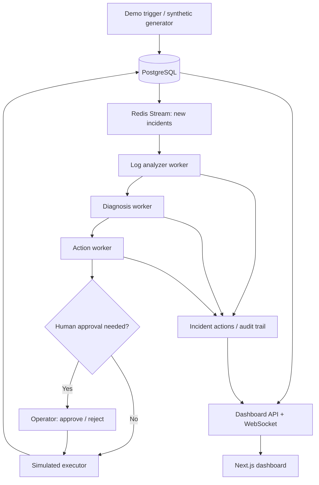

# Incident Triage Agent

A demo multi-agent incident triage system built with TypeScript, Bun, PostgreSQL, Prisma, Redis Streams, and Next.js. Specialized workers analyze logs, diagnose likely causes, recommend an action, and publish an incident timeline to a live dashboard. High-risk actions require an operator decision.

> **Demo and safety boundary:** The default executor is simulated. The project does not perform real production remediation. The incident generator creates synthetic incidents and deployments; the optional webhook can ingest external incident payloads, but that does not make the remediation path production-ready. Do not connect this demo to critical infrastructure.

## What It Demonstrates

- **Multi-stage agent pipeline:** Log analysis, diagnosis, action selection, and incident communication.
- **Stream-based work handoff:** Redis Streams coordinate independent workers; Redis Pub/Sub feeds live dashboard updates.
- **Persisted lifecycle and audit trail:** PostgreSQL stores incident status, agent decisions, approval metadata, and execution outcomes.
- **Human approval workflow:** Risky proposed actions can be approved or rejected by an operator. Escalated incidents can be marked resolved with a reason.
- **Safer action decisions:** Rollback proposals must use an identified deployment record ID. If no deployment is identified, the agent escalates instead of guessing.
- **Public demo controls:** The demo trigger creates synthetic incidents and is rate-limited. Public dashboard data and operator decisions are restricted to allowlisted demo scenarios.
- **Automated checks:** Backend unit tests, database-backed approval integration tests, frontend tests, linting, type checks, and a production build run through GitHub Actions.

## Architecture



## Tech Stack

- **Language and runtime:** TypeScript, Bun
- **AI:** Gemini API
- **Backend:** Bun HTTP servers and worker processes
- **Database:** PostgreSQL, Prisma
- **Messaging:** Redis Streams and Pub/Sub
- **Frontend:** Next.js, React, Tailwind CSS
- **Testing:** Bun test, Vitest, Testing Library
- **CI:** GitHub Actions

## Requirements

- Bun 1.3.4
- Docker with Docker Compose
- A Gemini API key from Google AI Studio

## Run Locally

### 1. Configure the backend

From the repository root:

```bash
cd backend
bun install --frozen-lockfile
cp .env.example .env
```

Open `backend/.env`. Keep the local PostgreSQL URL consistent with the credentials in `backend/docker-compose.yml`. Set `GEMINI_API_KEY` to your own key.

Keep `.env` private. Never commit or share API keys, database credentials, webhook secrets, or operator keys.

The required backend variables are:

- `DATABASE_URL`
- `REDIS_URL`
- `GEMINI_API_KEY`

`WEBHOOK_API_KEY` and `DASHBOARD_OPERATOR_KEY` are used for protected endpoints and operator decisions. Slack and Railway values are optional for the local simulated demo.

### 2. Start PostgreSQL and Redis

While inside `backend`, run:

```bash
docker compose up -d
```

Initialize the Prisma client and database:

```bash
bunx prisma generate
bunx prisma migrate dev
bun run seed:all
```

The seed command creates synthetic deployments and incidents. It does not automatically guarantee that all seeded incidents are queued for processing.

### 3. Start the workers

Open a terminal in `backend` and run:

```bash
bun run workers:start
```

Keep this terminal running.

### 4. Start the dashboard API

Open a second terminal in `backend`:

```bash
bun run dashboard-server
```

The dashboard API runs on port `3002` by default.

To process seeded open incidents, run this command in another backend terminal:

```bash
bun run enqueue-all
```

### 5. Start the frontend

Open another terminal from the repository root:

```bash
cd frontend
bun install --frozen-lockfile
bun run dev
```

Open the dashboard at:

**http://localhost:3000**

By default, the frontend calls the backend dashboard API at `http://localhost:3002`. To use a different API URL, configure `NEXT_PUBLIC_API_BASE` in the frontend environment before starting or building the app.

Use the dashboard's demo trigger to create a new synthetic incident. The demo trigger is rate-limited.

When approving or rejecting a proposed action, enter the operator key configured as `DASHBOARD_OPERATOR_KEY` in the backend environment.

## Testing and Quality Checks

Run backend checks with PostgreSQL and Redis available and `backend/.env` configured:

```bash
cd backend
bun test
bunx prisma validate
bun run typecheck
RUN_DB_INTEGRATION_TESTS=1 bun test src/workers/approvalWorkflow.integration.test.ts
```

Run frontend checks:

```bash
cd frontend
bun run test
bun run lint
bunx tsc --noEmit
bun run build
```

GitHub Actions contains separate backend and frontend workflows.

The backend workflow generates the Prisma client, validates the schema, prepares a test database, runs unit and approval integration tests, and type-checks the code. The frontend workflow runs tests, linting, TypeScript checks, and a production build.

### Evaluation

The evaluation harness can be run from `backend` after seeding and processing incidents:

```bash
bun run enqueue-all
bun run wait-batch
bun run eval
```

Evaluation results depend on the generated scenarios and configured model. A single local run should not be treated as a guarantee of production accuracy.

## API Notes

The dashboard server defaults to port `3002` and exposes a `/healthz` endpoint.

| Endpoint | Purpose |
|---|---|
| `GET /healthz` | Dashboard API health check |
| `POST /demo/trigger` | Create a synthetic demo incident |
| `POST /webhook/incident` | Ingest an incident payload |
| `POST /webhook/deployment` | Ingest a deployment payload |
| `POST /api/incidents/:id/approve` | Approve an eligible demo action |
| `POST /api/incidents/:id/reject` | Reject an eligible demo action |
| `POST /api/incidents/:id/resolve-escalation` | Record human resolution of an escalated demo incident |

Protected webhook routes require an `X-API-Key` header matching `WEBHOOK_API_KEY`. Dashboard approval and escalation-resolution endpoints require the operator key in the `X-API-Key` header.

Only use the resolve-escalation endpoint after a human has investigated the incident and recorded a meaningful resolution reason.

## Deployment Notes

The frontend can be deployed separately, but the backend requires more than a serverless API route. It needs:

- PostgreSQL
- Redis
- A persistent dashboard API and WebSocket service
- Long-running worker processes
- Secure environment-variable configuration

Set `NEXT_PUBLIC_API_BASE` to the publicly reachable dashboard API URL and configure backend secrets in the hosting provider's environment settings.

Before publishing a demo, verify WebSocket connectivity, health checks, database connectivity, worker health, and the full incident workflow in the deployed environment.

The `RailwayActionExecutor` in the codebase is a reference starting point, not a production-ready integration. Service IDs need configuration, and rollback is not implemented there.

## Current Limitations

- The default executor **simulates actions**. It does not modify real infrastructure.
- The Railway executor is incomplete and should be treated as a reference implementation only.
- Synthetic demo incidents and externally ingested incidents serve different purposes. The public demo UI is not a substitute for a production incident-management interface.
- Production deployment still requires environment-specific security review, observability, backup and recovery planning, and live end-to-end verification.
- Human approval and audit logging do not, by themselves, make real infrastructure remediation safe for production use.

## Security Checklist

- Never commit `.env` files, API keys, database URLs, webhook secrets, or operator keys.
- If a secret appears in a screenshot, terminal recording, log, or chat, revoke or rotate it and update local and hosted environment variables.
- Use separate development and hosted credentials.
- Restart or redeploy services after rotating credentials.
- Keep real remediation disabled until authorization, target validation, rollback planning, human approval, and recovery procedures have been reviewed and tested end to end.
